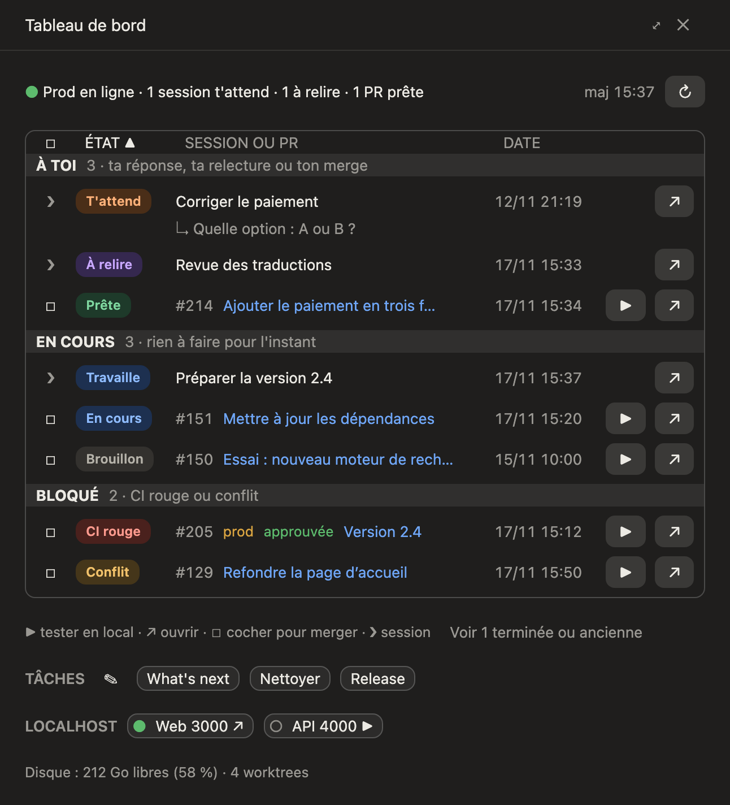

# agent-cockpit

**English** — A Claude Code pane, shown next to the chat in the desktop app: your Claude sessions and the open PRs of a GitHub repo in one table sorted by priority (« À toi » / yours, « En cours » / running, « Bloqué » / blocked), plus your repeated tasks and local servers as buttons. Buttons only send an instruction to Claude or open a link: none merges, pushes or starts a server by itself. The UI is in French.

Install, at a Claude Code prompt in a terminal:

```
/plugin install agent-cockpit --marketplace Heliosare/agent-cockpit
```

Then type `/cockpit`. Settings: `~/.claude/agent-cockpit/config.json`, created on first run; see `config.example.json`. Needs macOS, the Claude desktop app, `gh` signed in, `/usr/bin/python3`.

Contributions welcome: open an issue, or a pull request with the tests passing (see « Contribuer » below). MIT licence.

---

**Français** — Un panneau pour Claude Code, affiché à côté du chat dans l'app de bureau : tes sessions Claude et les PR ouvertes d'un dépôt GitHub dans un seul tableau, trié par priorité.



*Rendu simulé, avec des données d'exemple.*

## Ce qu'il montre

- **Trois groupes**, sessions et PR mélangées : « À toi » (une session t'attend ou est à relire, une PR est prête), « En cours », « Bloqué » (CI rouge, conflit, contrôle manquant). Un quatrième, « Terminé ou ancien », s'ouvre à la demande.
- **Trois colonnes** : l'état (une pastille de couleur), le titre, la date et l'heure. Un clic sur un en-tête trie les lignes à l'intérieur de chaque groupe.
- **Sur chaque ligne** : ▶ tester la PR en local, ↗ ouvrir la PR ou la session, ☐ cocher la PR pour un merge groupé.
- **Dessous** : tes tâches répétitives et tes serveurs locaux, en boutons, puis l'espace disque.

Les boutons ne font qu'envoyer une consigne à Claude ou ouvrir un lien. Aucun ne merge, ne pousse ni ne lance de serveur lui-même : c'est Claude qui agit, dans la session où tu as cliqué, avec ses règles habituelles.

## Ce qu'il faut

- macOS et l'app de bureau Claude : le panneau lit la liste des sessions que l'app garde sur ton ordinateur.
- `gh`, connecté à ton compte (`gh auth login`), pour lister les PR. Sans dépôt réglé, le panneau ne montre que les sessions.
- `/usr/bin/python3`, fourni avec les outils de développement d'Apple.

Testé avec Claude Code 2.1.325.

## Ce qu'il lit

Tout se passe sur ton ordinateur. Le panneau lit la liste des sessions de l'app (titres et états), `~/.claude/launch.json`, les ports locaux à l'écoute et l'espace disque. Il interroge GitHub avec ton `gh` pour le dépôt que tu as réglé, et l'adresse `santeProd` si tu en as donné une : ce sont ses seuls appels au réseau.

## Installer

Dans un terminal, à l'invite de Claude Code :

```
/plugin install agent-cockpit --marketplace Heliosare/agent-cockpit
```

Réponds `y` pour ajouter la source, puis choisis la portée « user ».

Depuis un shell :

```
claude plugin install agent-cockpit --marketplace Heliosare/agent-cockpit
```

Dans l'app de bureau, où `/plugin` ne s'exécute pas : clique sur + à côté de la zone de saisie, puis Plugins, « Add marketplace » avec `Heliosare/agent-cockpit`, puis « Add plugin ».

Ensuite, tape `/cockpit` dans une session pour ouvrir le panneau.

## Régler

Au premier lancement, le panneau pose `~/.claude/agent-cockpit/config.json`. Le crayon ✎ du panneau l'ouvre. Il est relu à chaque rafraîchissement : pas besoin de relancer quoi que ce soit.

| Réglage | Ce qu'il fait |
| --- | --- |
| `titre` | Le nom du panneau. |
| `repo` | Le dépôt GitHub dont on liste les PR, sous la forme `compte/dépôt`. Vide : pas de PR. |
| `depot` | Le dossier local de ce dépôt, pour compter ses worktrees. |
| `santeProd` | Une adresse à surveiller. Le panneau dit si elle répond. |
| `garde` | Un morceau du nom du contrôle qui doit être vert avant un merge. Vide : les autres contrôles décident seuls. |
| `labelOk` | Le label qui marque une PR approuvée. Il s'écrit sur sa ligne. |
| `brancheProd` | La branche de production. Ses PR portent la marque « prod » et ne se cochent qu'à la main, une par une. |
| `fuseau` | Le fuseau des dates, par exemple `Europe/Paris`. Vide : celui de l'ordinateur. |
| `joursAncien` | Après combien de jours sans mise à jour une PR bloquée est rangée avec les terminées (3 par défaut). |
| `ouvrirAuto` | `favorites` : le panneau s'ouvre tout seul dans les sessions mises en favori. `toujours` : dans toutes. `jamais` : seulement avec `/cockpit`. |
| `rafraichirSecondes`, `prsSecondes` | Le rythme : les sessions et les serveurs toutes les 30 s, GitHub toutes les 90 s. |
| `taches` | Tes boutons : `court` (le texte du bouton), `libelle` (son nom complet) et `texte` (la consigne envoyée à Claude). |
| `piles` | Les serveurs locaux à toujours montrer : `nom`, `port`, et soit `lanceur` (son nom dans `~/.claude/launch.json`), soit `dossier` et `commande`. Ceux de `launch.json` qui tournent s'ajoutent tout seuls. |
| `consignes` | Pour réécrire ce que les boutons demandent à Claude : `tester`, `merger`, `lancer` et `ok`. |
| `suivre` | Des débuts de titre, par exemple `["MVP"]`. Une session dont le titre commence ainsi reste visible une fois terminée, même archivée, dans un groupe « Suivi ». |
| `reponses` | Les réponses proposées sous une session qui t'a posé une question (par défaut : Oui, Non, Suis ta recommandation). Un clic envoie la réponse à cette session. |
| `qct` | Le chemin d'un script de résumé (voir plus bas), ou `false` pour s'en passer. |

Un exemple (voir aussi `config.example.json`) :

```json
{
  "titre": "Mon projet",
  "repo": "mon-compte/mon-depot",
  "depot": "~/code/mon-depot",
  "brancheProd": "main",
  "taches": [
    { "court": "Suite", "libelle": "Quoi faire ensuite", "texte": "Dis-moi ce qui reste à faire et par quoi continuer." }
  ],
  "piles": [
    { "nom": "Web", "port": 3000, "lanceur": "web" }
  ]
}
```

### Réécrire une consigne

Une consigne est un texte à trous. Le panneau remplit les trous puis envoie le texte à Claude.

- `tester` : `{numero}`, `{titre}`, `{branche}`.
- `merger` : `{liste}` (les PR cochées, dans l'ordre) et `{nombre}`.
- `lancer` : `{nom}`, `{port}` et `{detail}` (comment démarrer la pile).
- `ok` : `{label}`, `{numero}`, `{titre}` et `{fichiers}` (les tests que la garde signale). C'est la demande du bouton qui apparaît sous une PR dont la garde est rouge, quand `labelOk` est réglé : il demande d'abord confirmation, puis demande à Claude de poser le label, jamais de merger.

```json
{
  "consignes": {
    "merger": "Merge ces PR dans cet ordre : {liste}. Vérifie d'abord que la CI est verte."
  }
}
```

### Le résumé express

Si un script exécutable se trouve à `~/.claude/skills/qct/qct`, ou au chemin donné par `qct`, chaque session reçoit un bouton ≡. Pour les sessions de « À toi » et celles terminées depuis moins de trois jours, le panneau lance ce script dès que leur tour se termine, une fois par tour, et garde le résultat dans `~/.claude/agent-cockpit/resumes.json` : le bouton ne fait qu'afficher. Pour les autres sessions, le bouton le lance à la demande. Sans script, pas de bouton.

## Développer

```
claude plugin validate .
claude plugin test .
python3 tests/test_collect.py
```

- `hooks/register.tsx` dessine le panneau. `scripts/collect.py` rassemble les données et n'imprime que des champs choisis : titres, états, numéros.
- `outils/` sert à voir le panneau sans l'app, pour régler la mise en page.
- Sur l'app de bureau, un bouton affiche son `label` même s'il a des enfants. Le label d'une icône est donc le caractère lui-même, et son nom vit dans une carte de survol.

## Contribuer

Les issues et les pull requests sont les bienvenues.

1. Forke le dépôt et crée une branche.
2. Avant d'ouvrir la PR, lance les trois vérifications de la section « Développer » : elles doivent passer.
3. Garde le code générique : ce qui est propre à une équipe (dépôt, adresses, noms de piles, consignes) va dans les réglages, pas dans le code ni dans les tests.
4. Les boutons ne font qu'envoyer une consigne à Claude ou ouvrir un lien : aucun ne doit merger, pousser ou lancer quelque chose lui-même.

## Licence

MIT, voir [LICENSE](LICENSE).
